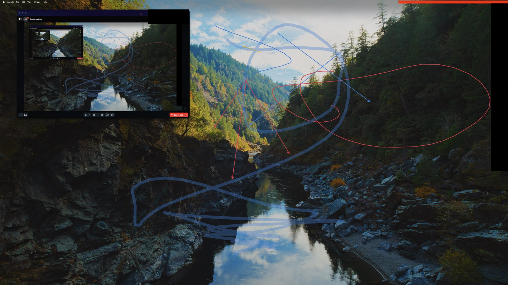
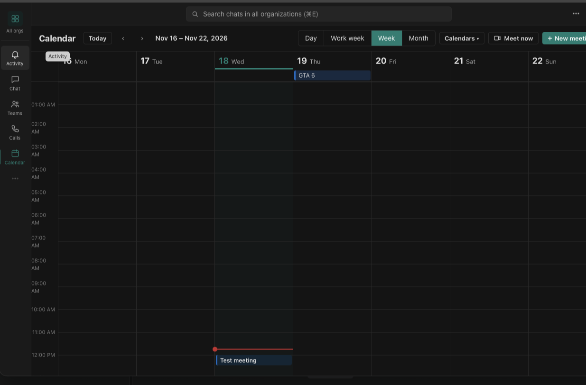
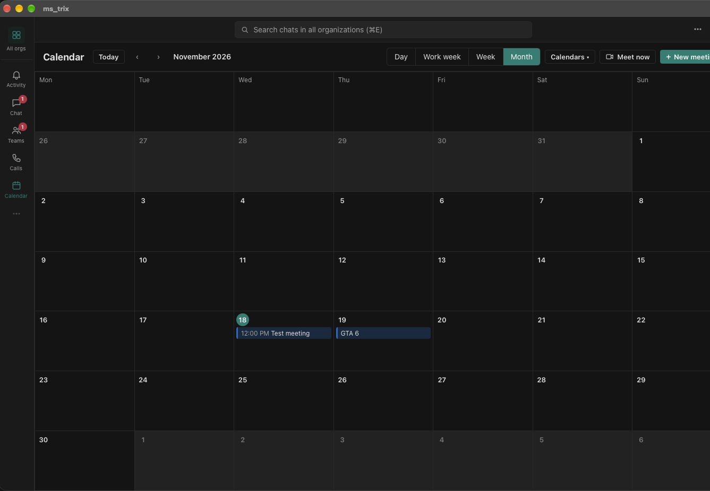
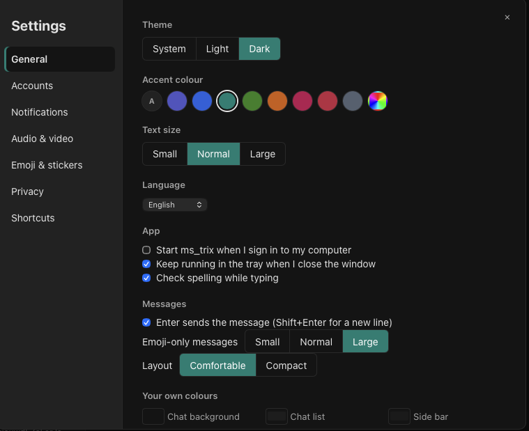

# ms_trix

One desktop app for your chats, meetings and calendar, on open protocols. ms_trix feels like
Microsoft Teams, but works with **Matrix** (end-to-end encrypted) and **Nextcloud Talk**, and with
several organisations at once.


> **Status:** early, in daily use and testing at SURF (matrix.surf.nl and SURF's Nextcloud
> Talk). Builds are not signed yet, so macOS and Windows will warn when you first open the app.

## Why

Many organisations run their own Matrix and Nextcloud servers but their people miss the
familiar Teams layout: one list of chats, teams with channels, a calendar, and calls that just
work. ms_trix puts those together in one window, for every account you have, while your
messages stay on your own servers.

## What it does

**Chat**
- Chats, rooms and channels in one list, grouped like Teams; unread, mentions and favourites
- Replies, threads, reactions, edits, forwarding (also between Matrix and Talk), files and
  images, voice messages, polls, Markdown and a format bar
- Search across all your history, from an index on your own device that is encrypted on disk
- A Shared tab per conversation: its media, files and links


**Organisations**
- Sign in to several Matrix and Nextcloud Talk accounts; switch with ⌘1–9, or see everything
  together under *All organizations* (⌘0)
- Teams view: Matrix spaces as teams with their channels

 

**Meetings and calls**
- Talk group calls with gallery, large gallery, speaker and pinned layouts
- Screen sharing with a red border around what you share, and drawing on your screen (pen,
  highlighter, arrow, laser pointer) so the others can follow along
- Background blur and pictures, raise hand, reactions, speaker choice
- Calls in the app or in a window of their own (for a second screen); moving between the two
  keeps the call going
- Matrix 1:1 voice and video calls
- Meet now, and Talk meeting settings (lobby, permissions, password, recording consent, …)




Talk meeting settings, right in the room's info panel:

 

**Calendar**
- Nextcloud calendar: day, work week, week and month; meetings with a Talk room; repeating
  meetings (edit one or the whole series)
- A reminder five minutes before each meeting, with Join; on top of your other windows, or
  inside the app if you prefer






**Make it yours**
- Light and dark themes, accent colours, text size, compact layout, your own colours per account
- English and Dutch

 

## Privacy and security

- Matrix messages are end-to-end encrypted (matrix-rust-sdk); you verify this device with your
  recovery key or another session
- Sign-in sessions are kept in the operating system's keychain
- The search index holds decrypted messages, so it is encrypted on disk with a key in the keychain
- ms_trix talks only to the servers of the accounts you add

## Building

You need [Rust](https://rustup.rs) (stable), [Node.js](https://nodejs.org) 20 or newer, and the
[Tauri prerequisites](https://v2.tauri.app/start/prerequisites/) for your platform.

```sh
cd apps/desktop
npm install
npm run tauri dev      # run the app while developing
npm run tauri build    # make an installer for this platform
```

Tests:

```sh
cargo test --workspace             # Rust: protocol adapters, unread model, search, calendar
cd apps/desktop && npm run build   # type check, locale check and frontend build
```

## How it is built

A [Tauri 2](https://tauri.app) app: a Rust core that talks to the servers, and a React and
TypeScript interface.

```
crates/
  trix-core/     the model shared by all protocols, the adapter interface, unread tracking
  trix-matrix/   Matrix (matrix-sdk, sliding sync, end-to-end encryption)
  trix-talk/     Nextcloud Talk (chat, calls, calendar over CalDAV)
  trix-search/   the encrypted full-text index
apps/desktop/
  src/           the interface (React)
  src-tauri/     the app host (Rust)
```

More in [ARCHITECTURE.md](ARCHITECTURE.md). What's done and what's next is in
[ROADMAP.md](ROADMAP.md): Zulip and Mattermost are the next protocols.

## Licence

ms_trix is free software: you can redistribute it and/or modify it under the terms of the
[GNU General Public License](LICENSE), version 3 or (at your option) any later version.

## Credits

Idea: William · Sponsored by [selectedwithtrust.com](https://selectedwithtrust.com) · Made with
Claude

---

ms_trix is not affiliated with or endorsed by Microsoft. Microsoft Teams is a trademark of
Microsoft Corporation.
